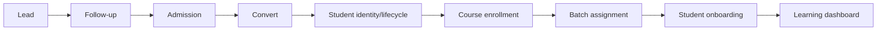
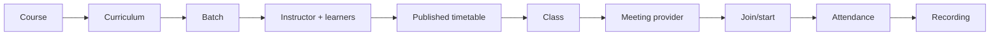
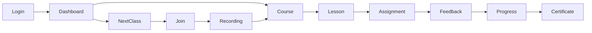
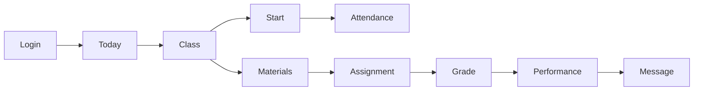
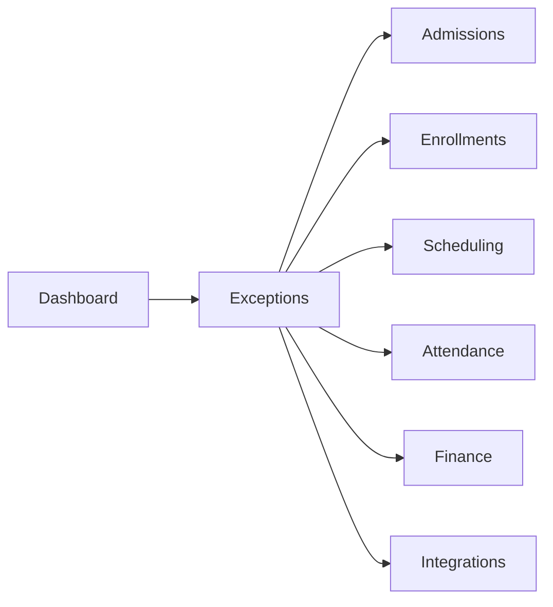
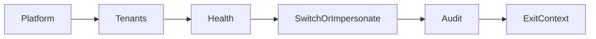

# User journey audit

These are reconstructed from routes, services and models. Browser behavior was not verified.

## A. Admission to learning

Current route path: `/admin/crm/leads` → lead detail → `/admin/crm/admissions` → `/admin/students/:id` → `/admin/courses/:id/students` and/or batches → `/student`. Permissions span CRM, admission conversion, lifecycle, enrollment and batch management. Conversion is implemented in `CRMService`; downstream Enrollment and Batch are separate domains. Friction: no single conversion workspace visibly confirms identity, fees, enrollment, batch and first-login readiness. Ideal: conversion result page with checklist and links, never an unsafe all-in-one transaction.

## B. Course to class

Current routes cross course detail/curriculum, batches, timetable, classes, attendance and recordings. Services/models support the dependency chain and provider operations. Friction: six top-level destinations obscure the lifecycle; completion and failure state of provider provisioning/recording is not consistently visible from class context. Ideal: a Course workspace with Batches, Curriculum and Outcomes tabs; Batch workspace with People, Schedule and Performance; Class detail as the operational hub.

## C. Student learning

The student dashboard already exposes next class and resume learning. Routes exist for course detail/player, assessments, attendance, recordings and certificates. Friction: these outcomes are separate sidebar modules and may lose course context. Ideal: keep dashboard shortcuts but place Lessons, Live & Recorded Classes, Assessments and Progress within each enrolled Course workspace.

## D. Instructor teaching

Instructor dashboard is action-oriented, with classes and pending grading. Friction: attendance is primarily reached through class operations while assessment, grading, students and communication are separate; preparation has no explicit lesson plan workspace. Ideal: class detail presents preparation, roster, meeting, attendance, resources and post-class recording; batch detail presents assessments/performance/messages.

## E. Administrative operations

The current dashboard and analytics are broad, but operational modules are list-first. Ideal dashboard prioritizes pending approvals, failed transitions, overdue dues, unfinalized attendance, unpublished schedules and provider failures, each deep-linked to a filtered queue.

## F. Platform operations

Platform routes support tenants, analytics/audit and impersonation. Missing proof: subscription infrastructure is not evident as a complete user-facing domain. Ideal: explicit context banner, reasoned impersonation, health/failure summaries and immutable audit trail.

Across all journeys, notifications should resolve to a canonical entity detail, preserve workspace/branch context, and offer a safe return path. This must be verified in Wave 0 E2E.
