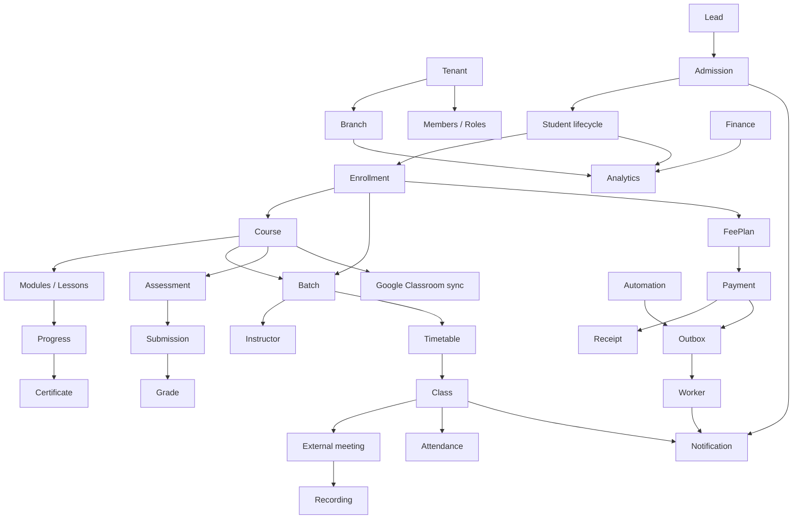

# Module dependency map

| Source → destination | Relationship / trigger | Implementation | User-facing gap |
|---|---|---|---|
| Lead → Admission → Student | explicit staff actions; conversion service | CRM controller/service, Admission/User/Lifecycle | conversion result lacks one downstream readiness checklist |
| Student + Course → Enrollment | admin enrollment | course/student services, Enrollment | enrollment and batch allocation live in different contexts |
| Course → Curriculum → public/student | publish readiness and catalog | publishing service, modules/lessons | good technical chain; next action after course creation should be prominent |
| Course → Batch → Timetable → Class | staff configuration/publish | batch and scheduling services/models | scattered top-level modules; state handoffs need contextual actions |
| Class → external meeting | provider orchestration and queued operation | LiveClassOrchestrator, adapters, IntegrationOperation | real provider failure/retry not certified; surface status on class detail |
| Class → Attendance | open/finalize/correct session | attendance service/models | post-class next action should be attendance finalization |
| Zoom meeting → Recording | webhook/worker sync | ZoomRecordingService, recording model/library | real webhook/storage lifecycle unverified |
| Course/Lesson → Progress → Certificate | lesson completion and eligibility | progress/certificate services | eligibility should surface within course completion state |
| Assessment → Submission → Grade | learner submit/instructor grade | assessment service/models | feedback/results need course/batch contextual links |
| Fee plan → Payment → Receipt/refund | gateway/manual payment and worker reconciliation | finance service, Razorpay, ledger/outbox | transactional suites skipped; admissions does not show payment readiness inline |
| Domain event → Automation/Notification | outbox and worker dispatch | DomainEvent, Outbox, worker dispatchers | operations UI needs failure queue and traceability |
| Canonical data → Analytics/export | query/aggregate/export | analytics services/model | aggregates require explicit tenant + branch certification |

Disconnected or weakly surfaced islands: AI capabilities (no clear UI), provider health/operation failures, cross-domain onboarding readiness, and subscription management. These must be clarified before promotion, not merely added to navigation.
