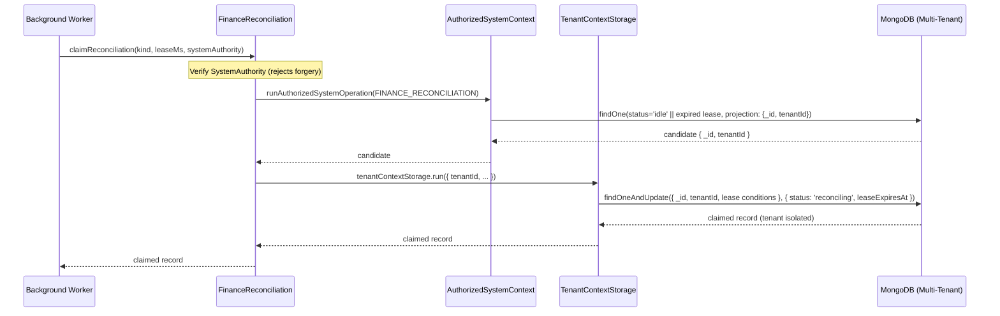

# Finance Reconciliation & Recovery Security

## Architectural Overview
Finance reconciliation operates across payments and refunds to reconcile local transaction states against external payment gateway reality (Razorpay). Because reconciliation is a background worker responsibility, it requires scoped discovery of candidate records without circumventing multi-tenant database isolation.

Prior to Batch 3, `financeReconciliation.ts` used unconstrained `__bypassTenantIsolation: true` in `claimReconciliation` and `releaseReconciliation`.

## Secure Capability Model

## Security Invariants Preserved
1. **Opaque Authority Verification:**
   Callers must pass a valid `SystemAuthority` minted via `createSystemAuthority('FINANCE_RECONCILIATION')`. Forged objects (`{ role: 'SYSTEM' }`) are rejected with `TenantContextMissingError`.
2. **Minimal Identifier-Only Discovery:**
   Cross-tenant candidate selection selects only `_id` and `tenantId`. No payment amounts, customer details, or financial ledger data are read during global discovery.
3. **Atomic Tenant-Bound Lease Claim:**
   The state mutation (`reconciliationStatus: 'idle'` -> `'reconciling'`) executes strictly within `tenantContextStorage.run` using the candidate's verified `tenantId`.
4. **Concurrency Safety & Idempotency:**
   Atomic compare-and-set prevents race conditions between parallel worker instances.
5. **Lease Expiry & Recovery:**
   Records stuck in `'reconciling'` whose lease has elapsed are eligible for recovery claim under the same bounded rules.
6. **Bounded Retries:**
   The 5-attempt limit (`reconciliationAttempts < 5`) is enforced, preventing runaway loops on perpetually failing gateway checks.
7. **Release Finalization:**
   `releaseReconciliation` discovers the target record's tenant binding under `FINANCE_RECONCILIATION` authority and updates reconciliation metadata inside `tenantContextStorage.run`.

